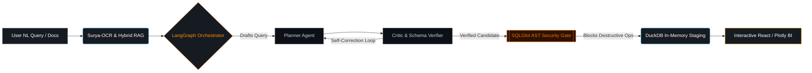
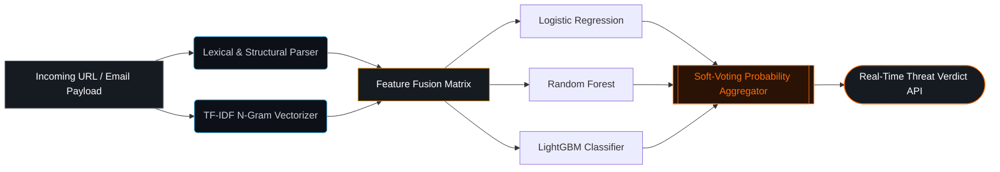

  
   
  

  

    
    
    
    
  

---

## ⚡ The Engineering Philosophy

> *"Anyone can wrap an API call around an LLM and call it a demo. Real software engineering begins when you have to make a probabilistic model behave deterministically inside a fault-tolerant production system."*

Hi, I'm **Harsh** — a Computer Engineering undergraduate at **MET's Institute of Engineering** and a **Full-Stack & Agentic AI Engineer**. While most developers treat Backend Systems and Artificial Intelligence as two separate worlds, I build at the exact seam where they meet.

<table>
  <tr>
    <td width="50%" valign="top">
      <h3>🧠 What Makes My Approach Different</h3>
      <ul>
        <li><b>Guardrails Before Generation:</b> I don't trust raw model outputs near production data. I build Abstract Syntax Tree (<code>SQLGlot</code>) validators, strict JSON-Schema contracts, and Human-in-the-Loop (HITL) gates.</li>
        <li><b>OLTP vs. OLAP Separation:</b> I design systems where AI-driven analytical workloads run in isolated in-memory sandboxes (<code>DuckDB</code>) so they never lock transactional customer databases (<code>PostgreSQL</code>).</li>
        <li><b>Algorithmic Backbone:</b> Daily problem-solver in <b>Java</b> across Dynamic Programming, Graph Theory, and Bit Manipulation—bringing clean time/space complexity discipline to system design.</li>
      </ul>
    </td>
    <td width="50%" valign="top">
      <h3>🎯 Current Engineering Radar</h3>
      <ul>
        <li><b>Stateful Multi-Agent Topologies:</b> Orchestrating cyclic planner-critic reflection loops using <code>LangGraph</code> and the <code>Model Context Protocol (MCP)</code>.</li>
        <li><b>Schema-Driven Generative UI:</b> Translating unstructured human intent into live, validated <code>React</code> component trees and interactive BI dashboards.</li>
        <li><b>Zero-Day Threat Heuristics:</b> Combining lexical feature extraction with soft-voting gradient boosted ensembles for real-time cybersecurity defense.</li>
      </ul>
    </td>
  </tr>
</table>

---

## 🏛️ Interactive System Blueprints (Live Architecture)

*Unlike static text diagrams, the blueprints below are rendered natively via GitHub Mermaid—you can pan, zoom, and inspect the exact data flow of my flagship systems.*

### 1. `OmniDash` — Autonomous Multi-Agent NL-to-SQL & Decision Intelligence
**The Challenge:** Enterprise teams sit on massive relational databases and unstructured PDFs, but non-technical stakeholders cannot write complex multi-join SQL, and engineering teams cannot risk letting an unguarded LLM touch production databases.

* **How It Works:** Ingests both relational schemas (`PostgreSQL`) and unstructured documents (`Surya-OCR` + `PGVector`/`ChromaDB`). A stateful `LangGraph` workflow plans the query, critiques join paths, passes the SQL through an AST syntax blocker (`SQLGlot`) to guarantee read-only safety, stages aggregations in `DuckDB`, and streams visual insights to a `React` frontend.
* **Why It Matters:** Published as a primary research paper, awarded **1st Runner-Up at Project Poster Presentation 2K26**, and built as our flagship system for **Smart India Hackathon (SIH)**.

---

### 2. `ApexPhishGuard` — Multi-Model Soft-Voting Threat Intelligence Engine
**The Challenge:** Traditional blacklists fail against newly minted, zero-day phishing domains, while heavy deep-learning models introduce too much latency for real-time browser and email inspection.

* **How It Works:** Extracts structural URL lexical signatures alongside TF-IDF token vectors, feeding them concurrently into a calibrated ensemble of `Logistic Regression`, `Random Forest`, and `LightGBM` exposed via a low-latency REST microservice.
* **Why It Matters:** Outperformed standalone classifiers in false-positive suppression and clinched **🏆 1st Place at the upXgen State-Level Hackathon (AI Domain)**.

---

### 3. Production Full-Stack & Predictive Engines
| System | Architectural Problem Solved | Core Engineering Stack |
| :--- | :--- | :--- |
| **[Forma-AI](https://github.com/Harsh-1324/Forma-AI-AI-Augmented-Dynamic-Form-Engine)** | Eliminates manual form-builder boilerplate by converting natural language prompts into strict, schema-validated, interactive UI forms with automated database persistence. | `React.js` `Node.js` `LangChain` `PostgreSQL` `JSON-Schema` |
| **[Foresight](https://github.com/Harsh-1324/foresight-demand-inventory)** | Solves retail stockout and overstock risks by benchmarking gradient-boosted weekly SKU demand curves against seasonal-naive baselines. | `Python` `LightGBM` `Pandas` `Scikit-learn` `Time-Series` |
| **[Customer Segmentation](https://github.com/Harsh-1324/Intelligent-Customer-Segmentation-Behavioral-Analytics)** | Transforms raw transactional logs into actionable behavioral clusters for targeted retention strategies. | `Python` `Unsupervised ML` `Clustering` `Data Pipelines` |
| **[Mastek FinTech Tracker](https://github.com/Harsh-1324/mastek-ml_based_expense_tracker)** | Full-stack polyglot architecture pairing an Express/React web portal with an isolated Python ML microservice for automated expense categorization. | `React.js` `Express` `Python` `REST Microservices` |

---

## 🧰 The Technology Matrix

  

    
    
    
    
    
  

  

    
    
    
    
    
    
  

  

    
    
    
    
    
    
  

---

## 💼 Experience, Leadership & Milestones

* ⚡ **Software Developer — Deployra Private Limited:** Engineering scalable backend architectures, asynchronous API orchestration, and production AI workflow integrations.
* 💻 **Web Development Intern — Sunanda Infotech:** Architected reusable `React.js` frontend component systems and AI-augmented dynamic form workflows for client applications.
* 🏛️ **Technical Advisory Head — SACC (MET Institute of Engineering):** Spearheading architectural code reviews, technical workshops, and mentoring student engineering teams across the department.
* 🏆 **Honours & Recognition:**
  * 🥇 **1st Place Winner** — *upXgen State-Level Hackathon (AI Domain)*
  * 📄 **Primary Research Author** — *Autonomous Multi-Agent Text-to-SQL & Dynamic BI Generation*
  * 🥈 **1st Runner-Up (2nd Prize)** — *Institute Project Poster Presentation 2K26*
  * 🚀 **National Semi-Finalist** — *Mastek Project Deep Blue (Season 11)*
  * ☁️ **Certified** — *AWS Academy Cloud Foundations* & *Quantum Computing (IIT Roorkee & C-DAC)*

---

## 🔥 Contribution Velocity & Activity Grid

  

 

  <!-- Automated Daily Orange Contribution Snake -->
  

---

  <samp>
    <b>Designed &amp; Engineered by Harsh Gupta</b> • Always open to discussing Distributed Systems, Agentic AI &amp; SDE Opportunities
  </samp>

